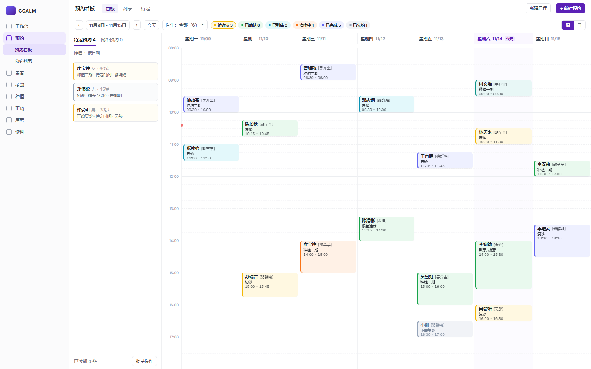

# 预约看板设计方案

> 目标：在 CCALM 后台新增一级导航「预约」，参考 e看牙（领健）预约看板的结构与逻辑，做一个适配本门诊（单店、自研、React + Vite + NestJS + Prisma）的预约看板。
>
> 本文档只做分析与方案，不含实现代码。文中截图来自 e看牙线上环境（吴移风口腔诊所，2026-11 数据）。



---

## 1. 结论先行

1. e看牙的看板本质是「**一张按医生×时间铺开的工作台**」：周视图按天分列、日视图按医生分列，15 分钟为最小刻度，卡片颜色=预约状态，点卡片出患者+预约浮层，左侧常驻「待定预约」作为拖拽排期的蓄水池。
2. 它真正的复杂度不在网格，而在**状态机 + 预约与「到店/挂号/病历/收费」的联动**。这个联动我们已经有了一半：`PatientVisit` 就是「就诊」，状态里已经有 `booked`，工作台的「待接诊」就是它。
3. 因此推荐**不新建“预约表”，而是把 `PatientVisit` 升级成“预约/就诊”单表**：预约=一条 `status=booked` 的就诊；到店、写病历、收费继续沿用现有链路。好处是不产生双表同步、不迁移历史数据、病历/收费的关联天然闭合。
4. 分期：P0 先做「导航 + 周视图看板 + 新建/改约 + 状态流转」（可用），P1 做「列表、待定、拖拽、医生看板、排班」；P2 做「提醒、网络预约、统计」。

---

## 2. e看牙预约看板拆解

### 2.1 信息架构

```
左侧一级导航：预约
└─ 顶部 Tab：预约看板 ｜ 预约列表 ｜ 网络预约
   ├─ 预约看板
   │  ├─ 左栏：月历（可切双周）· 待定预约/网络预约 · 医生筛选 · 已过期 N 条 · 批量操作
   │  └─ 主区：筛选工具条 + 时间网格（周视图=7 天；日视图=医生看板）
   ├─ 预约列表：所有预约/待定/已取消/已失约 + 条件筛选 + 导出 + 批量修改
   └─ 网络预约：线上渠道进来的待确认预约
右上角：新建预约 · 新建日程 · 设置
```

### 2.2 看板布局与视图

| 区域 | 内容 | 说明 |
| --- | --- | --- |
| 工具条 | 日期区间 `11月9日 - 11月15日` ‹ ›、全部科室、`医生：12`、8 个状态图例、收起、`日/周` | 图例本身就是**状态筛选器**（多选 chip） |
| 左栏 | 月历（`看双周`切换）、`待定预约`/`网络预约` 两个 tab、医生下拉、`筛选`/`排序`、`已过期 0 条`、`批量操作` | 待定预约是**拖拽排期的来源** |
| 周视图 | 7 列（周一…周日），列头 `星期六(11/14) 今`，15 分钟细格，08:00–21:00+，今天列高亮 | 竖向时间轴吸顶/吸左 |
| 日视图 | 列=**医生**（`医生看板`），列头 `余煌(2)` + `正常班` 班次标签，`当值医生(12)/全部医生(12)` 切换 | 屏幕放不下时右下角 `+N 点击查看更多` |
| 卡片 | 状态底色 + 姓名 + `[医生]` + 项目 + `09:30 - 10:00` + 病历号 + 小角标（性别/来源/状态） | 同一医生同时段重叠时自动并排（lane 分栏） |

### 2.3 卡片形态与状态色（实测取值）

| 状态 | 色值 | 语义 |
| --- | --- | --- |
| 预约 | `#FFDB1D` | 已登记、未确认（列表里显示为「未确认」） |
| 已确认 | `#62EB56` | 电话/微信确认过 |
| 已到店 | `#3FDBEF` | 已到店/已挂号，等待接诊 |
| 治疗中 | `#FF9F67` | 医生接诊中 |
| 治疗完成 | `#8790FF` | 病历写完 |
| 已结账 | `#C4F4FF` | 收费完成 |
| 已离开 | `#E4E5E7` | 离店 |
| 已失约 | `#939EBB` | 未到店 |

列表里还会出现 `已挂号`、`保存`（草稿）等细分值，说明状态机比图例更细，图例是"看板关心"的子集。

### 2.4 关键交互

1. **新建预约**：右侧抽屉（不是弹窗）。左列患者信息（搜索患者 / 患者 / 手机 / 病历号 / 备注），中列预约信息（就诊类型、`*预约时间`、`*持续时间` 30 分钟、`*医生`、`*预约诊所`、备注），右列预约项目树（按分类折叠 + 搜索 + 多选 checkbox：定期复诊/口腔检查/牙体/口外/修复/种植/正畸/牙周）。
2. **拖拽排期**：抽屉保存后出现"把它拖到看板中即可设定医生和时间"的引导；左侧「待定预约」同样可拖到网格任意医生/时段。
3. **点卡片**：浮层里上半是患者摘要（病历号、年龄、电话、备注、来源、消费总额、欠费），下半是 `预约详情 / 预约记录` 两个 tab，底部 `修改`、`更多`（跨诊所改约、再次预约）。
4. **新建日程**：主题、时间、全天、参与人；勾选「参与人」后该时段**医生不可再约**（占用）。
5. **状态流转**：卡片右键/浮层改状态，或在列表里批量改；失约、取消会留痕（日志）。
6. **设置**：预约提醒服务、短信模板、术前提醒、语音提醒（挂号通知医生/治疗完成通知前台/报价通知前台/收费完成通知医生）、自动失约服务、预约项目配色、预约视图显示病历号/备注、就诊流程模式（强/弱）、有效预约条件（按状态/按是否收费）、挂号到店来源、挂号费流程。

### 2.5 隐含的数据模型

```
预约 Appointment：患者 · 医生 · 日期/开始/时长 · 预约项目[] · 状态 · 就诊类型 · 备注 · 创建人 · 来源 · 状态流水
日程 Schedule(占用)：主题 · 起止 · 参与人[] · 是否全天
项目字典 AppointmentItem：分类 > 项目名 · 是否启用 · 配色
网络预约 OnlineBooking：来源渠道 · 期望时间 · 待确认 → 转预约
```

---

## 3. 我们系统现状（差距分析）

### 3.1 已有资产（可直接复用）

| 能力 | 位置 | 复用点 |
| --- | --- | --- |
| 患者档案 | `Patient`（name/phone/chartNo/gender/birthday/age/tags/remark） | 患者搜索、卡片摘要 |
| 就诊记录 | `PatientVisit`（visitDate/startTime/endTime/kind/status/doctor/remark） | **就是预约载体**，`status` 已含 `booked` |
| 员工 | `User`（displayName）+ `GET /patients/staff` | 医生下拉（现为自由文本 + 建议列表） |
| 排班/班次 | `ScheduleEntry`（每日 full_rest/morning_rest/afternoon_rest）+ `ShiftConfig`（上午 08:30–12:00、下午 14:30–18:00） | 医生看板的班次标签、休息时段置灰 |
| 病历/收费 | `MedicalRecord`、`ChargeOrder`（均挂 `visitId`） | 状态自动推进：写完病历=治疗完成，收完费=已结账 |
| 收费项目 | `FeeCategory` / `FeeItem` | 预约项目候选（免建字典） |
| 工作台 | `workbench.service`（今日 `patientVisit`） | 「待接诊」已是 booked 就诊，看板同源 |
| 交互组件 | shadcn 全套 + `@dnd-kit` + `dayjs` + `sonner` | 拖拽、日期、提示均已有依赖 |
| SSE | `lib/api.ts` 补卡事件流 | 预约变更推送可复用同一套写法 |

### 3.2 缺口

- ❌ 跨患者的**时间网格**：现在只有「患者详情-就诊记录」时间线和「工作台今日列表」，没有按天/按医生铺开的视图。
- ❌ 预约字段：持续时长（可由起止推导）、**预约项目**、创建人、来源（前台/网络/病历/系统）、确认人/确认时间、到店时间。
- ❌ 状态细分：e看牙 的 `已确认/治疗中/已结账/已离开` 我们**不做**，只保留 4 状态（见 4.3）；`待定` 用 `isPending` 标记，不占状态位。
- ❌ 待定预约池、冲突检测、改约留痕、提醒。
- ⚠️ **耦合点**：`medical-records.service.ts:115/156` 和 `orthodontics.service.ts:179` 用 `status in ["booked","arrived"]` 找"开放就诊"。新增状态后必须抽成共享常量，否则写病历时会重复建就诊。

### 3.3 两种建模选择

| | 方案 A（推荐）扩展 `PatientVisit` | 方案 B 新建 `Appointment` 表 |
| --- | --- | --- |
| 表数量 | 1 | 2（+ 到店时生成就诊） |
| 数据一致性 | 天然一致，无同步 | 需同步状态、防双写 |
| 病历/收费闭环 | 直接挂 visit | 需 appointmentId → visitId 映射 |
| 历史数据 | 0 迁移（现有 booked 就诊自动出现在看板） | 需迁移现有 booked 就诊 |
| 语义 | 「就诊」包含未到店的预约（轻微重载） | 语义清晰 |
| 适用 | 单店、预约≈就诊前态 | 多店、网络预约、预约与就诊强分离 |

**推荐 A。** 预约就是"还没到店的就诊"，符合现有 `booked` 语义和工作台「待接诊」的口径；等到真需要网络预约/多门店再拆。

---

## 4. 方案设计

### 4.1 导航与路由

```
ccalm-web/src/config/routes.ts         + appointments: { board: "/appointments", list: "/appointments/list" }
ccalm-web/src/config/appointments-nav.ts  (新建，仿 patients-nav.ts)
ccalm-web/src/components/app-sidebar.tsx   插入「预约」（CalendarDays 图标，工作台之后、患者之前）
ccalm-web/src/components/main-layout.tsx   顶部 NavigationMenu 同步加一项
ccalm-web/src/App.tsx                      路由 + lazy 页面
```

一级「预约」下挂两个子项（可折叠，仿「考勤」）：

- `预约看板` `/appointments`
- `预约列表` `/appointments/list`

> 「待定预约」不单独占一级入口，作为看板左栏的一个 tab 存在；`设置` 放 P1 的独立弹层/页面。

### 4.2 页面与组件结构

```
pages/appointments/
  AppointmentBoardPage.tsx      看板页（工具栏 + 左栏 + 网格）
  AppointmentListPage.tsx       列表页（P1）
  components/
    board-toolbar.tsx           日期区间/医生/科室/状态图例/日周切换/新建
    status-legend.tsx           状态 chip（颜色 + 计数 + 筛选）
    time-grid.tsx               纯展示网格：列 × 15min 行、吸顶列头、吸左时间轴、当前时间线
    appointment-card.tsx        卡片（状态色、姓名、医生、项目、时段、角标、min-height）
    appointment-drawer.tsx      新建/编辑抽屉（患者搜索 + 预约信息 + 项目树）
    appointment-popover.tsx     点卡片浮层（患者摘要 + 详情/记录 tab + 操作）
    patient-picker.tsx          患者搜索（姓名/拼音/手机/病历号）
    item-picker.tsx             预约项目多选（分类折叠 + 搜索）
    pending-panel.tsx           待定预约池（拖拽源）
    schedule-dialog.tsx         新建日程（占用医生时段，P1）
  hooks/use-appointments.ts     拉取 + 缓存 + 轮询/SSE 刷新
  lib/appointments/status.ts    状态枚举、中文、颜色、可流转矩阵（+ .test.ts）
  lib/appointments/layout.ts    重叠卡片分道算法（纯函数，+ .test.ts）
```

网格列有两种模式：

- **周视图**：`columns = 7 天`，卡片跨列为 0（一列内按医生堆叠，重叠分道）。
- **医生看板（日视图）**：`columns = 当天出诊医生`，列头带 `当日预约数` 与班次（`正常班`/`上午休`/`下午休`）。

### 4.3 数据模型（Prisma）

```prisma
model PatientVisit {
  // ... 现有字段保持不变（patientId / visitDate / startTime / endTime / kind / doctor / remark）
  /// 预约项目名称（来自独立的预约项目字典，多选），空数组=未填
  items        String[]  @default([])
  /// 预约来源：manual 手工录入（护士/医生） | network 网络 | record 病历/疗程 | system 系统生成
  source       String    @default("manual")
  /// 创建人（User.id，可为空：历史数据/小程序）
  createdById  String?
  /// 到店 / 治疗完成 的时间戳（履约统计用；"到店"不是状态）
  arrivedAt    DateTime?
  completedAt  DateTime?
  /// 待定：无医生或无确定时段（见 4.9）
  isPending    Boolean   @default(false)
  /// 待定原因：patient_time 患者时间 | doctor_schedule 医生排班 | lab 加工件 | consult 多医生会诊
  pendingReason String   @default("")
  /// 取消/失约原因
  cancelReason String    @default("")
  @@index([visitDate, status])
  @@index([visitDate, doctor])
  @@index([isPending, visitDate])
}
```

状态取值（`status` 仍为字符串，沿用现有风格；用常量收敛）—— **2026-11-14 确认只保留 4 个状态**：

```ts
export const VISIT_STATUSES = [
  "booked",    // 预约（未到店、已到店未治疗都停在这一档）
  "completed", // 治疗完成
  "missed",    // 已失约
  "cancelled", // 已取消
] as const;

/** 病历/收费仍可挂靠的“开放就诊”：只剩 预约 */
export const OPEN_VISIT_STATUSES = ["booked"] as const;
```

配套约定：

- **“到店”不是状态，是时间戳**：`arrivedAt` 有值 = 已到店。前台点「到店」只写时间，状态仍是 `booked`；工作台「待接诊」= 今日 + `booked` + `arrivedAt` 为空，到店后转「待治疗完成」。
- **待定不是状态**：`isPending=true` 表示没定医生/时间（见 4.9）。
- **历史数据迁移**：现有 `arrived` 行按「有没有挂病历」映射为 `completed` / `booked`；`completed / missed / cancelled` 原样保留。迁移前先跑只读统计核对条数。
- **必须同步改造（状态收敛的连带改动）**：代码里有多处写死 `"booked"` / `"arrived"` 来判断"这条就诊还开着、可以挂病历"。改成 4 状态后，`arrived` 这个值不再产生，这些判断会失配，表现为"写完病历状态不推进""又新建一条重复就诊"。逐个换成共享常量：

  | 位置 | 现在 | 改成 |
  | --- | --- | --- |
  | `medical-records.service.ts:115` 找当天开放就诊 | `["booked","arrived"]` | `OPEN_VISIT_STATUSES`（= `["booked"]`） |
  | `medical-records.service.ts:156` 写病历后推进状态 | 同上 | 同上 |
  | `orthodontics.service.ts:179/184/187/198` 正畸点「就诊」复用/建就诊 | 同上 | 同上（`arrived` 改成"写了 `arrivedAt` 的 booked"） |
  | `patients/patient-groups.ts:11` 已就诊患者判定 | `["arrived","completed"]` | `["completed"]`（真实到诊口径） |
  | `workbench/rows` + `WorkbenchPage.tsx` 待接诊/待治疗完成计数 | 按 `booked`/`arrived` 两档 | 待接诊=`booked` 且无 `arrivedAt`；待治疗完成=`booked` 且有 `arrivedAt` |
  | `ccalm-web/lib/visits/pending-visit.ts:20` 默认挂哪条就诊 | `booked`/`arrived` | `booked` |
  | `visit-options.ts`（前后端）状态字典 | 5 值 | 4 值 |
  | `visit-dialog.tsx:50` 新建默认状态 | `arrived` | `booked` |

- **收费完成不占状态位**：看板用「关联收费单已全额支付」推导一个小角标即可，P2 再做。

### 4.4 状态机（4 状态版）

```
                    ┌──── 改约（改日期/医生/时长，仍是 booked，写日志）────┐
                    ▼                                                    │
[待定 isPending] ──排期──> 预约(booked) ──写病历──> 治疗完成(completed)（终态）
                              │  ▲
                     到店（记 arrivedAt，不改状态）
                              │
                              ├──患者没来──────> 已失约(missed)
                              ├──提前通知不来──> 已取消(cancelled)
                              └──删除（仅未到店，建议仅管理员）
```

规则：

- `booked` 是唯一的"活"状态，也是唯一能挂病历/收费的状态。
- **「治疗完成」只由写病历触发**，前台不提供"点完成"按钮；写病历时自动 `completed`（现有 `syncVisit` 逻辑不变）。
- 边界：患者到店但没写病历就走（只咨询/只拍片），会一直停在 `booked`。处理方式是停在"已到店未完成"里，用看板上的超时提醒（到店超过 N 小时未写病历→标黄）催办；必要时前台可改「已取消」并填原因。
- 失约/取消只能从 `booked` 出发，必须填原因（`cancelReason`）；可撤销（改回 `booked` 并写日志）。
- 待定：`isPending=true` 且**不占医生时段**；排期后 `isPending=false`。
- 所有流转写一条 `AppointmentLog`（P1）。

### 4.5 接口设计（NestJS，新建 `modules/appointments`）

| 方法 | 路径 | 说明 |
| --- | --- | --- |
| GET | `/appointments/board?from&to&doctorIds&statuses&view` | 看板主数据：按日期分组的预约 + 每日计数 + 医生列表（含班次） |
| GET | `/appointments/pending` | 待定预约池（按待定原因分组） |
| GET | `/appointments?from&to&doctorId&status&keyword&page&pageSize` | 列表分页（P1） |
| GET | `/appointments/meta` | 医生（`bookable`）、护士（`assistable`）、预约项目树、状态字典、默认时长 |
| POST | `/appointments` | 新建（患者、医生、时段、项目、备注；`isPending=true` 时允许无医生/无时段） |
| PUT | `/appointments/:id` | 编辑/改约（含排期 `isPending: false`） |
| POST | `/appointments/:id/arrive` | 到店：写 `arrivedAt`，状态不变 |
| POST | `/appointments/:id/complete` | 治疗完成（仅写病历自动调用；前台无入口） |
| POST | `/appointments/:id/miss` | 失约（带 `reason`） |
| POST | `/appointments/:id/cancel` | 取消（带 `reason`） |
| POST | `/appointments/:id/revert` | 撤销失约/取消，回到 `booked` |
| DELETE | `/appointments/:id` | 删除（仅待定/未到店） |
| GET | `/appointments/conflicts?doctorId&date&start&end&excludeId` | 冲突检测（拖拽时实时提示，不阻断） |
| POST | `/appointments/schedules` | 新建日程占用（P1） |
| POST | `/appointments/pending/rollover` | 过期批量顺延（P1，body: `{doctorIds, expireRange, newDate}`） |

**约定（与现有模块一致）**：`PUT` 全量更新、`POST :id/<动词>` 做状态动作、`DELETE` 删除；不做 `PATCH /status` 这种自由传状态值的接口——4 个状态用 4 个明确动词，天然阻止非法流转。

响应示例（board）：

```json
{
  "range": { "from": "2026-11-09", "to": "2026-11-15" },
  "days": [
    { "date": "2026-11-09", "counts": { "booked": 3, "completed": 8, "missed": 1, "cancelled": 0 } }
  ],
  "doctors": [
    { "name": "吴介尘", "count": 4, "shift": "normal", "shiftLabel": "正常班" }
  ],
  "appointments": [
    {
      "id": 101, "patientId": 12, "patientName": "姚政委", "chartNo": "260114",
      "age": 53, "gender": "male", "phone": "189****7018",
      "visitDate": "2026-11-09", "startTime": "15:00", "endTime": "15:45",
      "doctor": "吴介尘", "kind": "return", "status": "completed",
      "items": ["种植二期"], "isPending": false, "remark": ""
    }
  ]
}
```

约定：沿用现有 `visitDate: "YYYY-MM-DD"` + `startTime/endTime: "HH:mm"` 字符串（与 `PatientVisit`、`ScheduleEntry` 一致，避免时区坑）；不引入 `DateTime` 存预约时刻。

### 4.6 前端关键算法

1. **网格渲染**：CSS Grid/绝对定位，行高 `24px / 15min`（可配 20–32），纵轴从 `ShiftConfig.morningRangeStart - 30min` 到 `afternoonRangeEnd + 30min`；列宽均分，最少 120px，横向滚动。
2. **重叠分道**：预约按 `start` 排序，维护 lane 的 `end` 数组，放进第一个空 lane → `left = lane/n * 100%`、`width = 100%/n`。纯函数 `layoutDay(appointments)`，加单测（重叠 2/3 条、跨午休、同一时刻 4 条）。
3. **拖拽改约**（`@dnd-kit`）：拖起显示 15 分钟吸附；落点换算 `date + start`，按卡片高度保留时长；落点冲突给黄色边框 + toast「该时段医生已有预约，仍要保存？」；确认后 `PUT /appointments/:id` 乐观更新。
4. **待定池拖入**：与 3 共用 DndContext，落点=医生列 + 时间 → 直接 `PUT` 排期。
5. **刷新策略**：进入页面拉一次；窗口聚焦 + 60s 轮询；P1 换 SSE（`/appointments/events`，复用 `lib/api.ts` 的补卡事件写法）。
6. **性能**：单周 ≤300 条直接渲染；两周/月视图按列虚拟化或只渲染可视区间。避免每次 render 重算 layout（`useMemo` key=日期+数据版本）。

### 4.7 视觉规范

- 卡片：浅色底 + **左侧 3px 状态色条** + 状态圆点，字色 `--foreground`；这比 e看牙的大色块更贴合本项目的 shadcn 风格（若想 1:1 复刻，可直接用其色值做纯色底）。
- 状态色（4 状态 + 待定，基于 e看牙 色系收敛）：

  | 状态 | 主色 | 卡片底色 |
  | --- | --- | --- |
  | 待定（`isPending`） | `#EC4899` 粉 | `#FDF2F8` |
  | 预约（`booked`） | `#F2B705` 琥珀 | `#FFFBEB` |
  | 治疗完成（`completed`） | `#17A34A` 绿 | `#F0FDF4` |
  | 已失约（`missed`） | `#64748B` 蓝灰 | `#F1F5F9` |
  | 已取消（`cancelled`） | `#94A3B8` 灰 | `#F8FAFC` + 删除线 |
  | 到店标记（`arrivedAt` 有值，**不是状态**） | `#0891B2` 青 | 卡片右上角小圆点 |
- 卡片内容优先级：`姓名 [医生]` → `项目` → `时段` → `病历号`（≤30 分钟只显示前两行，hover 出全量）。
- 今天列：`bg-primary/5` + 列头 `今天` badge；当前时间：1px 红线（`--destructive/60`）。
- 空态：`今日暂无预约` + 「新建预约」按钮；加载骨架屏用现有 `Skeleton`。
- 暗色：状态底色统一走 `color-mix(in oklab, var(--status) 12%, transparent)`，避免另写一套暗色值。

### 4.8 权限

按角色（= 岗位 + 权限，见 4.13）判断，不再用 `user/admin`：

| 角色 | 能力 |
| --- | --- |
| 全部登录用户 | 查看看板/列表（需 `appointment.view`）；医生、护士都能**新建/改预约**、点「到店」、改状态（失约/取消） |
| 医生（`bookable=true`） | 可被预约；默认只看自己（可切全诊所）；写病历即治疗完成 |
| 护士（`assistable=true`） | 建/改预约、到店登记、配台；默认无删除权 |
| 管理员角色 | 含 `staff.manage` / `salary.view` / `appointment.settings` 等，可管理角色权限 |

- 「谁能被预约」= 该用户任一角色 `bookable=true`；**不看角色名**。
- 「谁能配台」= 该用户任一角色 `assistable=true`。
- 没有专职前台，`appointment.create` 默认给医生和护士两个角色。

沿用全局 `JwtAuthGuard`，再叠加一层 `PermissionsGuard`（见 4.13）。

### 4.9 待定预约（e看牙实测 + 是否照做的判断）

> 结论：**是一个"占位池"，不是新状态**。我们做不做，取决于前台是否经常出现"患者说下周再约/等通知"的情况。三档方案见本节末尾。

**e看牙怎么定义**

- 待定预约 = 非正式/临时预约：患者有意向、但时间或医生没定死（"下周三左右"、"等加工件到"、"要两个医生一起看"），先登记占位，**不占用具体医生时段**。
- 早期版本它只在"待定预约"列表里，不进看板；你环境 2026-11-11 刚升级的 V4.21.2 起，可以显示在看板上（粉色卡片 `#FFBBE3`，颜色可配）。

**怎么创建**

- 新建预约时不指定医生（`未指定医生`）/时间没定死，保存后进入待定池；左栏「待定预约」tab 里能看到。
- V4.19 起支持「待定原因」：患者时间待定 / 医生排班待定 / 加工件未到 / 需多医生会诊，可按原因筛选。

**怎么排期（三个入口，弹同一个确认框）**

1. 看板上直接拖动待定卡片到目标日期/时段；
2. 从左栏待定列表把卡片拖到看板的目标医生列/时段；
3. 点卡片 →「修改」→ 确认时间，转成普通预约。
   三种操作都会弹**同一个提醒弹窗**，可以"直接保存"或"再修改"；确认后卡片在看板上的位置同步更新。

**在板上怎么放**

- 与确定时间的预约区分展示（粉色 + 明显"待定"标识）；
- **没有时间的待定预约**，按设置里配置的时间段占位显示（比如固定挂在 08:00 那行），不占真实时段；
- 卡片字段沿用普通预约：姓名、预约项目、备注；点开可看详情、改时间、取消。

**过期与批量**

- 待定有"期望日期"，过了日期就变「已过期」；左栏底部显示 `已过期：N 条`。
- 点 `批量操作` → 弹「批量操作已过期」：按**医生** + **过期范围**（已过期 1 周内/…）筛选 → 显示"符合以上条件的待定预约共 N 条" → 统一把日期改到某一天。这是前台每周清理滞约的主要动作。

**权限**：删除待定预约是独立权限点（2024 年就加了），展示与操作沿用预约数据权限。

**我们的设计（如果做）**

```prisma
model PatientVisit {
  isPending     Boolean @default(false) // 待定：无医生 / 无确定时段
  pendingReason String  @default("")    // 可选：patient_time | doctor_schedule | lab | consult
  // 待定也必须有 visitDate（期望日期），才能判断"已过期"
}
```

- 待定卡片固定排在左栏，不占网格；排期 = 补充 `doctor` + `startTime/endTime` 并把 `isPending` 置 false。
- 「已过期」= `isPending` 且 `visitDate < 今天`；批量操作 = 按医生/过期区间筛出来，统一 `visitDate`。

**三档，按需选（已选 C：完整复刻）**

| 档 | 范围 | 估时 |
| --- | --- | --- |
| A 不做 | 新建预约必须选医生和时间；"没定"就让前台先不录 | 0 |
| B 最小可用 | `isPending` + 左栏列表 + 拖到网格排期 + 编辑排期 + 已过期计数 | 1–1.5 人日 |
| **C 完整复刻 ✅ 已选** | B + 待定原因 + 看板粉色卡片 + 无时间卡片占位时段 + 过期批量顺延 + 卡片底色配置 | 2.5–3 人日 |

> C 档的细节对齐 e看牙：卡片底色可配（默认 `#FFBBE3`）、无时间的待定按设置里的"待定显示时段"占位、三个排期入口共用同一个确认弹窗、过期批量按"医生 + 过期范围"筛选后统一改期、删除待定是独立权限点。

### 4.10 员工岗位：参考 e看牙，我们怎么定

**e看牙实测（管理 → 人事管理 → 员工管理）**

- 员工筛选有**两组完全独立的维度**：`岗位`（全部岗位：**医生 / 护士 / 前台 / 技师**）和 `角色`（全部角色，15 个系统角色）。
- 角色列表：公司管理员、诊所管理员、牙科助手、牙医、行政、前台、咨询师、客服、网电咨询师、库房、采购、财务、网电主管、学生、总经理。
- 表格列：所属诊所 / 姓名 / 员工号 / 性别 / 生日 / **岗位** / 手机 / 安全认证 / 工作诊所 / **工作科室** / 在职状态 / 登录账号 / **所属角色**。
- ⚠️ 现实很说明问题：这家 11 个员工**岗位全是"医生"**，真实身份只体现在角色上（牙医 / 牙科助手,前台 / 公司管理员,牙医）。结果角色是"牙科助手,前台"的卢彤，照样出现在预约看板的医生列里——**岗位直接决定"谁可以被预约"，一旦不维护就成了脏数据**。

**结论：岗位/身份必须立刻被消费，否则一定腐坏；但不必学它拆成两套概念。**

我们把 e看牙 的「岗位 + 角色」合并成一张 `Role`（`bookable` / `assistable` 表身份、`permissions` 表权限），详见 4.13。这里只保留三条原则：

- **只分医生和护士**（已确认）：助理医师归 `doctor`（设 `bookable=true`），前台/行政不设岗位（没有专职前台）。
- **不设技师/咨询师，不加科室**。
- **身份字段必须立刻生效**，否则会像 e看牙 这家一样全变"医生"：
  1. 预约「医生」下拉 = `bookable=true`；
  2. 病历「配台护士」选人 = `assistable=true`；
  3. 看板医生列 / 医生筛选 = 同上。
- 人员管理里角色必选；内置角色不可删改，避免把"医生"改名后预约下拉空掉。

### 4.11 病历里的「助理 / 护士」到底为什么存在

**标准情况（为什么要有）**

| 用途 | 说明 |
| --- | --- |
| 可追溯/举证 | 病历是唯一法律文书。出现器械遗留、材料型号错、术后感染时，要能查到"这一台是谁配的、材料谁准备的、器械谁消毒的" |
| 四手操作分工 | 口腔是团队操作：医生在口内，护士吸唾/传递/调材料/灯光/术前术后宣教，种植/拔牙还需要第二人核对 |
| 绩效与工作量 | 护士/助手的奖金常按"配台台次/工作量"分。e看牙的绩效就有 `医生 / 咨询师 / 护士 / 辅助护士` 四个口径，靠病历上的人员归属来算 |
| 材料与成本归集 | 种植体、修复材料、耗材通常由护士领用准备，记人能对上库房消耗 |
| 院感与器械追溯 | 器械包、种植工具盒的流转责任人 |
| 质控/带教 | 抽查配台是否规范、新人跟台情况 |

**但「助理」和「护士」在国内是两个身份**

- **助理 = 助理医师**：有执业助理医师证，可以在指导下做部分操作，属医疗岗；
- **护士 = 护理岗**：配台、消毒、材料、宣教，属护理岗；
- 很多门诊没有助理医师，两个字段其实指同一批人——e看牙的角色里就直接叫「牙科助手」。

**e看牙 实际怎么做**

- 病历卡片上固定有：`科室 / 医生 / 助理 / 护士 / 费用 / 诊所 / 相关标签`（截图为姚政委 2026-11-09 那条复诊病历）；
- 但这条病历的**助理、护士都是空的**——字段存在、不强制、不参与结算，就没人填；
- 它真正驱动填写的是绩效：绩效模块按 `医生 / 咨询师 / 护士 / 辅助护士` 出数（见 [V4.21.2 发版说明](http://ekyhelp.linkedcare.cn/docs/e-kan-ya-V4-21-2-geng-xin-26-nian-11-yue)），谁的病历谁拿钱，字段才有维护动力。

**我们现状**

- `MedicalRecord.assistant` / `nurse` 已存在（自由文本 + StaffCombobox），但**只用于展示**，没有任何统计/绩效/结算消费；
- 工资模块用的是另一套"护士池 + 扣减比例"，与逐条病历无关；
- 结论：现在这两个字段是 **0 价值 + 增加录入负担**，而且不填也不会有任何后果——和 e看牙 一样的结局。

**已定：只留一个可选「配台护士」，不做考核**

| 方案 | 做法 | 结论 |
| --- | --- | --- |
| A 删掉 | 病历不再记配台人员 | 不选 |
| **B 合并成一个「配台护士」（已选）** | 删掉 `MedicalRecord.assistant` 字段，只留一个可选的 `nurse`（配台护士），选人限 `assistable=true` 的角色；**仅用于病历追溯/质控，不参与绩效** | ✅ |
| C 保留助理+护士两栏 | 各自统计 | 不选 |

- 助理医师归入 `doctor`，不单独占字段；`MedicalRecord.assistant` 列的数据迁移时并入 `MedicalRecord.nurse`（`nurse` 为空才覆盖），随后删除该列。
- 因为不做配台费，这个字段**设为可选**（不强制），不填也不影响任何计算——它的价值只在"出事能查到谁配的台"。

### 4.12 配台工作量奖金：暂不做（留档备查）

**已确认：不算配台费，员工只分医生和护士。** 下面这些算法只记录备查，将来要做时直接取用；P0 不实现。

**先分清两个身份**

- **助理医师**：有执业助理医师证，属医疗岗，可在指导下接诊/操作——不是"配台"，本方案归入 `doctor`；
- **配台护士**：护理岗，吸唾、传递、调材料、消毒、宣教——配台工作量算在护士身上。
- 病历里最终只保留：`医生（主诊，必填）/ 配台护士（可选）`。

**五种常见算法**

| 模型 | 公式 | 例子 | 优点 | 缺点 |
| --- | --- | --- | --- | --- |
| ① 台次单价（最常用） | 月奖金 = Σ(台次 × 分档单价) | 普通台 8 元、根管 12、正畸 20、种植/外科 50；护士月 100 台≈1200 元 | 直观、好解释 | 大家抢简单台，要分档 |
| ② 医生业绩比例 | 配台奖金 = 所配医生业绩 × 1%~2%，按台次占比分 | 医生月业绩 20 万 × 1.5% = 3000，两位护士按台次 6:4 分 | 与产出挂钩、数据要求低 | 业绩波动大，护士不可控 |
| ③ 固定 + 台次 + 质控 | 底薪含基础配台，超出 N 台后按单价加，出问题扣 | 底薪含 60 台，超出 8 元/台，投诉/返工扣 50/次 | 公平、可控 | 规则多，要人维护 |
| ④ 积分制 | 每个项目设"配台积分"，月积分 × 单价 | 洁牙 1、补牙 2、根管 3、种植 10；100 分 × 12 元 | 项目差异大时最公平 | 要维护每个项目的积分 |
| ⑤ 奖金池平均分（你们现在工资模块的做法） | 全店/医生收入 × 比例 → 护士按出勤系数分 | 护士池 = 收入 × 0.2% | 最简单 | 大锅饭，多干不多得 |

**将来若要做，推荐：① 台次单价（分 3 档）**

理由：11 人、3~4 个护士、项目集中（种植/修复/正畸复诊），分档单价就够，不需要积分制那么细。

参考参数（按你们客单价调）：

| 档 | 项目 | 单价 |
| --- | --- | --- |
| 简单 | 洁牙、检查、拆线、换药 | 5 元 |
| 常规 | 补牙、根管、拔牙、取模、戴牙 | 10 元 |
| 复杂 | 种植一期/二期、外科、正畸粘托槽 | 30–50 元 |

- 主配 70%、辅配 30%（双人配台时）；
- **真要做，病历配台护士就得改必填**，否则统计不全；
- 返工/投诉/器械遗留 → 该台次不计或倒扣。

**结论：P0 不做。** 只把字段留住（可选、能追溯），等哪天要算钱再开。

**与现有工资模块的关系**：现在的 `tiered / chen_pool / lu_pool / xu_pool` 是"业绩提成/池子"；将来若加配台奖金，是另一条独立项，两者相加不冲突。

### 4.13 权限模型：角色 = 岗位 + 权限（可编辑），一张角色表搞定

**已定（2026-11-14 修订）：不再分 `role` / `staffRole` 两个字段，合并成一个「角色」。** 管理员可以在「人员与角色」页里改某个角色能做什么，不用改代码。

**数据模型**

```prisma
model Role {
  id          String     @id @default(uuid())
  name        String     @unique                 // 管理员 / 医生 / 护士 / 自定义
  bookable    Boolean    @default(false)         // 可作为「预约医生」
  assistable  Boolean    @default(false)         // 可当「配台护士」
  permissions String[]   @default([])            // 权限点（见下表）
  builtin     Boolean    @default(false)         // 内置角色：不可删除、不可改名
  sortOrder   Int        @default(0)
  users       UserRole[]
}

model UserRole {
  userId String
  roleId String
  @@id([userId, roleId])
}

model User {
  // 删除 role: user|admin 与 staffRole，改为多角色
  roles UserRole[]
}
```

**为什么是两个布尔，而不是 `kind` 枚举**

`kind` 只服务于两件事：**能不能被预约**、**能不能配台**。用枚举就会出现"管理员算哪种身份？"这种问题（我一开始写 `kind=other` 就是这个尴尬）。改成两个布尔后：

- 管理员：`bookable=false, assistable=false`，名字就叫"管理员"，不需要解释；
- 医生：`bookable=true`；
- 护士：`assistable=true`；
- 以后加"技师""只读"角色，不用改枚举，也不会出现"other"。

**为什么多角色（一个人可挂 2 个）**

- 吴介尘既是医生又是管理员：挂「医生 + 管理员」两个角色即可；
- 如果只能单角色，就得造出「医生（兼管理员）」这种组合角色，角色数量会指数膨胀；
- 权限取并集；「谁能被预约」看**任一角色 `bookable=true`**——判断依据是字段，**不是角色名**（角色名随时可改）。

**内置角色（可再新建）**

| 角色 | 可被预约 | 可配台 | 默认权限 |
| --- | --- | --- | --- |
| 管理员 | 否 | 否 | 全部 |
| 医生 | 是 | 否 | 预约 + 病历 + 患者 + 收费查看 |
| 护士 | 否 | 是 | 预约（看/建/改）+ 到店 + 患者查看 + 病历查看 |

**权限点目录（代码里固定，约 16 个，按模块分组）**

| 模块 | 权限点 |
| --- | --- |
| 预约 | `appointment.view` 看板/列表、`appointment.create` 新建/改约、`appointment.edit_any` 改他人预约、`appointment.delete` 删除、`appointment.export` 导出、`appointment.pending` 待定批量、`appointment.settings` 预约设置（项目字典/时长/底色） |
| 患者 | `patient.view`、`patient.edit` |
| 病历 | `record.view`、`record.edit` |
| 收费 | `charge.view`、`charge.edit` |
| 薪资 | `salary.view` |
| 人员 | `staff.manage`（人员与角色管理） |
| 考勤 | `attendance.manage` |
| 报表/库房 | `report.view`、`warehouse.manage` |

**界面**

- 新页面「人员与角色」：左边员工列表（姓名 / 角色徽章 / 手机 / 状态），右边角色列表（名称 / 类型 / 可被预约 / 人数）→ 点角色弹出「权限勾选」面板（按模块分组，全选/反选）；
- 员工编辑：角色多选（可勾多个）。

**防呆（必须有，否则会把自己锁死）**

1. 内置角色不可删除、不可改名；
2. 保存角色时校验：**全系统至少还有一个用户拥有 `staff.manage`**；
3. 不允许删除仍有用户的角色；
4. 修改自己的角色要二次确认。

**接口层怎么落地**

- JWT 里只留 `userId`；守卫按请求加载"用户 + 角色 + 权限并集"（11 人，内存缓存 30 秒足够）；
- 新增 `@RequirePermissions("appointment.delete")` 装饰器 + `PermissionsGuard`，替换现有 22 处 `role !== "admin"` 判断（`users`、`salary`、`attendance`）；
- 前端 `usePermissions()` 返回权限集合，按钮级隐藏（删除/导出/设置），路由级拦截（人员与角色页）。

**代价**：比"两级权限"多约 **2 人日**（角色表 + 页面 + 守卫 + 迁移），换来的是以后调权限不用找开发。

> 迁移：现有 `admin` → 管理员角色；其余 `user` → 医生角色（先默认，上线后逐个改成护士）；`role` 列保留一个版本周期后再删。

---

## 5. 分期与工作量

| 阶段 | 范围 | 产出 | 估时 |
| --- | --- | --- | --- |
| **P0 可用版** | 导航/路由、**角色与权限**（`Role` 表 + 人员与角色页 + `PermissionsGuard`）、`PatientVisit` 扩展 + 迁移、`appointments` 模块（board/create/update/status/meta）、周视图网格、状态色与图例筛选、新建/编辑抽屉、点卡片浮层、冲突提示、空/错/载态 | 能替代微信群排班 | 5–6 人日 |
| **P1 好用版** | 预约列表（筛选/导出/批量改状态）、**待定预约 C 档**（原因/占位/过期批量/拖拽排期）、拖拽改约、医生看板（日视图）+ 排班/休息、日程占用、`AppointmentLog`、SSE 刷新、设置项（显示病历号/备注、默认时长、待定底色与占位时段） | 前台日常全流程 | 4–5 人日 |
| **P2 增强** | 自动失约、短信/微信提醒（小程序订阅消息）、网络预约 tab、履约统计（到店率/失约率/医生产能）、收费完成自动结账、打印/交接单 | 运营闭环 | 3–5 人日 |

P0 文件清单（便于排期）：

- `ccalm-api/prisma/schema.prisma` + 1 个 migration（`Role` / `UserRole`、`PatientVisit` 预约字段、`assistant` 并入 `nurse`、历史 `arrived` 映射；无破坏性）
- `ccalm-api/src/modules/roles/*`（角色 CRUD、权限目录）；`common/permissions/*`（装饰器 + 守卫）
- `ccalm-api/src/modules/appointments/{appointments.module,controller,service}.ts` + `dto/*` + `appointment-options.ts`
- `ccalm-api/src/modules/visits/visit-options.ts` 扩充状态；`medical-records`/`orthodontics` 改用 `OPEN_VISIT_STATUSES`
- `ccalm-web/src/pages/roles/*`（人员与角色页）；`lib/permissions.ts` + `usePermissions`
- `ccalm-web/src/config/{routes,appointments-nav}.ts`、`app-sidebar.tsx`、`main-layout.tsx`、`App.tsx`
- `ccalm-web/src/pages/appointments/*`（见 4.2）
- `ccalm-web/src/lib/visits/visit-options.ts` 增加 label；`lib/appointments/{status,layout}.ts` + 两个 `*.test.ts`

---

## 6. 测试与验收

**单测（vitest / jest，与仓库现有风格一致）**

- `layoutDay`：0/1/2/3 条重叠、首尾相接不算重叠、跨午休、时长 15 分钟。
- 状态机：合法流转表、非法流转抛错、到店幂等（重复点不产生第二条就诊）。
- 冲突检测：同医生重叠、同患者同日重复、跨天不冲突。
- `medical-records`：新增状态后写病历仍能复用开放就诊（回归现有用例）。

**手工验收清单**

1. 侧边栏与顶部导航都出现「预约」，刷新/直接输 URL 都不 404。
2. 新建预约 → 出现在看板对应列、位置与时长正确；刷新后仍在。
3. 改约拖动 → 时间/医生变化并落库；冲突时提示但可选择继续。
4. 到店 → 工作台「待接诊」出现该患者；写病历 → 看板变「治疗完成」。
5. 取消/失约 → 从看板消失（或按筛选显示），列表可查。
6. 图例点击 → 只显示对应状态；计数同步。
7. 医生筛选、日期前后翻页、今天按钮、日/周切换。
8. 空数据、接口 401/500、超长患者名、项目过多时的换行与截断。

---

## 7. 决策记录与待确认

**已确认（2026-11-14）**

1. **单表**：扩展 `PatientVisit`，不新建独立预约表。
2. 状态只要 4 个：预约 / 治疗完成 / 已失约 / 已取消（"到店"用 `arrivedAt` 时间戳表达，不占状态位）。
3. **「治疗完成」只由写病历触发**，前台无"完成"按钮。
4. 全项目不引入「科室」概念（看板不做科室筛选）。
5. **角色合并**：不再分 `role` / `staffRole`，统一成一张 `Role` 表（`bookable` 可被预约 + `assistable` 可配台 + `permissions[]`），用户可挂多个角色（见 4.13）。
6. **权限可配置**：内置 管理员 / 医生 / 护士 三个角色，管理员在「人员与角色」页可改任意角色的权限点（约 16 个，按模块分组）；不做 e看牙 的上百权限点/数据安全矩阵。
7. **病历人员**：只留「医生（必填）+ 配台护士（可选）」，删掉 `assistant` 字段（数据并入 `nurse`）；**不算配台费**，字段仅用于追溯。
8. 预约项目**单独维护**（`AppointmentCategory` + `AppointmentItem`：分类、名称、配色、启停、排序），不复用收费项目。
9. **待定预约做 C 档（完整复刻）**，见 4.9。
10. 默认持续时间 **30 分钟**，可选 15/30/45/60/90。

**仍待确认**

1. 提醒渠道（小程序订阅消息 / 短信）与是否接网络预约来源 —— 不阻塞 P0，P2 再定。

**角色落地（详见 4.13）**

```prisma
model Role {
  name        String   @unique
  bookable    Boolean  @default(false)   // 可被预约
  assistable  Boolean  @default(false)   // 可配台
  permissions String[] @default([])
  builtin     Boolean  @default(false)
}
model UserRole { userId String; roleId String; @@id([userId, roleId]) }
```

- 预约「医生」下拉 / 看板医生列 = 拥有 `bookable=true` 角色的用户（**看字段，不看角色名**）；
- 病历「配台护士」选人 = 拥有 `assistable=true` 角色的用户；
- 人员管理里角色必选（可多选），内置角色不可删改；至少保留一个用户拥有 `staff.manage`。

---

## 8. 实现规范（编码约定）

### 8.1 命名与常量

| 项 | 约定 |
| --- | --- |
| 状态值 | `booked / completed / missed / cancelled`（英文常量，不改） |
| 状态中文 | 预约 / 治疗完成 / 已失约 / 已取消（集中在 `visit-options.ts`） |
| 来源 | `manual / network / record / system` |
| 待定原因 | `patient_time / doctor_schedule / lab / consult` |
| 权限 key | `domain.action` 小写点分，如 `appointment.delete`（全表见 4.13） |
| 时间 | 日期 `YYYY-MM-DD`、时刻 `HH:mm`（字符串，不进 `DateTime`，避免时区坑） |
| 记录时间戳 | `arrivedAt` / `completedAt`（`DateTime`，只用于统计，不参与查询条件） |
| 组件/文件 | 前端 kebab-case 文件名、PascalCase 组件；后端 `xxx.controller/service/module/dto` |

状态常量只有**一个来源**：`ccalm-api/src/modules/visits/visit-options.ts`（`VISIT_STATUSES` / `OPEN_VISIT_STATUSES` / 中文 label）。前端 `lib/visits/visit-options.ts` 保留 label+颜色映射，并加一个单测断言"key 集合与后端一致（4 个）"。

### 8.2 后端结构

```
ccalm-api/src/
  common/permissions/
    permissions.ts          // 权限目录 + 分组（唯一来源）
    require-permissions.decorator.ts
    permissions.guard.ts    // 读 user+roles（内存缓存 30s）
  modules/roles/
    roles.controller.ts     // GET/POST/PUT roles；PUT :id/permissions
    roles.service.ts
    roles.seed.ts           // 内置三角色
  modules/appointments/
    appointments.controller.ts
    appointments.service.ts
    appointment-conflicts.ts // 纯函数：区间重叠判断（+ 单测）
    dto/{create,update,status-reason,rollover}.dto.ts
```

- DTO 用 `class-validator`，错误信息中文；时长枚举 `[15,30,45,60,90]`，默认 30。
- 状态动作一律 `$transaction`：改 `PatientVisit` + 写 `AppointmentLog`（P1 建表，P0 可先不写日志）。
- 冲突检测放纯函数 `hasOverlap(a, b)`：`a.start < b.end && a.end > b.start`（`HH:mm` 定长字符串可直接比较），配单测（相邻不算重叠）。
- 权限守卫失败统一 `ForbiddenException("无权限")`；业务错误 `BadRequestException("...")`。
- 查询列表统一返回 `{ total, rows }`（与现有分页接口一致），看板返回按天聚合对象（见 4.5）。

### 8.3 前端结构

```
ccalm-web/src/
  pages/appointments/
    AppointmentBoardPage.tsx
    components/{board-toolbar,status-legend,time-grid,appointment-card,
                appointment-drawer,appointment-popover,patient-picker,
                item-picker,pending-panel}.tsx
  pages/roles/RolesPage.tsx
  lib/appointments/{status.ts,layout.ts,conflicts.ts}   // 纯函数 + 单测
  lib/permissions.ts   // PERMISSIONS 目录（与后端同 key）+ can()
  hooks/use-permissions.ts, use-appointments.ts
```

- 网格：`time-grid` 只负责渲染（列、行、当前时间线），数据与布局由 `layoutDay()` 产出；`useMemo` key = `date + dataVersion`。
- 拖拽：`@dnd-kit`，`DndContext` 提到页面级，卡片与待定池共用；落点换算集中在 `lib/appointments/drag.ts`。
- 变更后先乐观更新本地 state，失败回滚 + `toast.error(errorMessage(e))`（沿用现有 `lib/errorMessage`）。
- 所有按钮级权限走 `can("appointment.delete")`，不在页面里写 `role === "admin"`。

### 8.4 校验规则（前后端一致）

| 规则 | 说明 |
| --- | --- |
| 时长 | 15–120 分钟，15 的倍数；默认 30 |
| 时段 | `startTime < endTime`，同一天内 |
| 待定 | 允许无医生、无时段；`isPending=true` 时 `startTime/endTime` 可为空 |
| 冲突 | 同医生时段重叠 → **提示但允许保存**（`force: true`）；同患者同日重复 → **拒绝** |
| 状态 | 只能按 4.4 的箭头走；`completed` 为终态；失约/取消必须带原因（≥2 字） |
| 删除 | 仅 `isPending` 或未来未到店；已完成的走"取消/隐藏"不删 |
| 权限 | 每个写接口都要 `@RequirePermissions`；`appointment.edit_any` 决定能否改他人预约 |

### 8.5 迁移与上线顺序

1. **备份**：`pg_dump` 一份；记录 `PatientVisit` 按 status 的条数、`MedicalRecord.assistant` 非空条数；
2. **迁移脚本**（单个 migration，含数据回填）：
   - 建 `Role` / `UserRole` / `AppointmentCategory` / `AppointmentItem`，插入三个内置角色；
   - `User` 加 `roles` 关系，`admin` → 管理员角色，其余 → 医生角色；
   - `PatientVisit` 加 `items/source/createdById/arrivedAt/completedAt/isPending/pendingReason/cancelReason` + 三个索引；
   - `MedicalRecord.assistant` 非空且 `nurse` 为空 → 写入 `nurse`，然后删列；
   - `PatientVisit`：`arrived` → 有病历 `completed`，无病历 `booked`；
3. **部署顺序**：先 api（兼容旧前端，`/visits` 接口保持字段不变）→ 再 web；
4. **回滚**：`role` 列保留一个版本周期；迁移前的 SQL 备份可直接反向执行。

### 8.6 质量门

- 每次提交前：`pnpm check`（编码检查 + web check + api check + 测试）；
- 新增纯函数必须带单测：`layoutDay`、`hasOverlap`、状态流转表、权限守卫（含"至少一个 staff.manage"）；
- 提交信息沿用仓库格式：`feat(api,web): 新增预约看板与角色权限 (#xxx)`；
- 分支：`feat/web-appointment-board`（不直接推 master）。

---

## 附：e看牙参考截图

截图未入库，保存在本机 `C:\Users\ccalm\ego\linkedcare-appt-20261114\`：

- `board.png` 周视图看板
- `new-appt-drawer.png` 新建预约抽屉
- `card-detail.png` 卡片浮层
- `list.png` 预约列表
- `day-view.png` 医生看板（日视图）
- `settings.png` 预约相关设置项

待定预约相关（本机 `C:\Users\ccalm\ego\linkedcare-pending-20261114\`）：

- `pending-shown.png` 左栏待定预约面板
- `batch-menu.png` 「批量操作已过期」弹窗
- `list-pending-tab.png` 预约列表-待定预约
- `drawer.png` 新建预约抽屉（医生默认为"未指定医生"）
